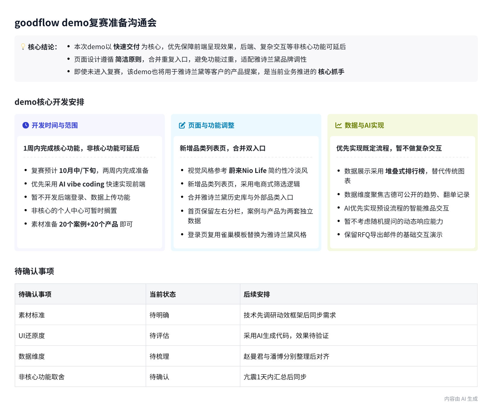
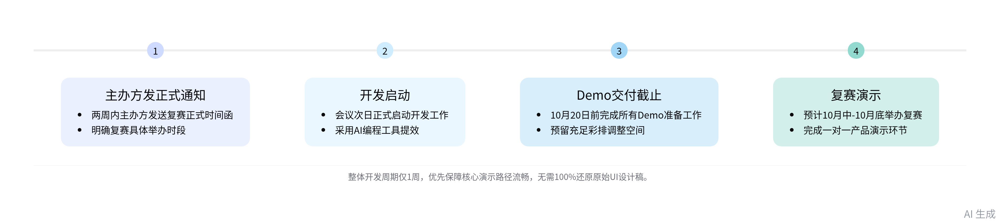
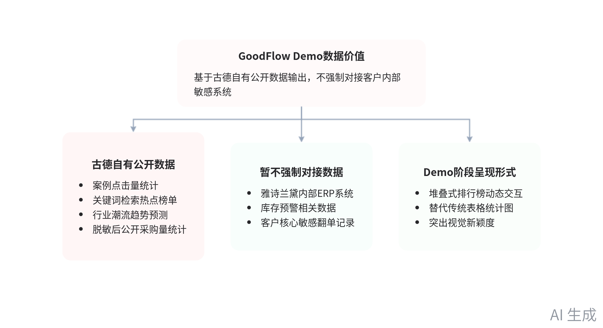

# 智能纪要：goodflow demo亢总沟通(西雅图) 2026年10月9日

来源：[飞书文档](https://rcnx5pcpd1kj.feishu.cn/docx/IdPTdprSvo7MMsx4cZccgTL0nic?dcuId=7497926674827214851)

> 会议主题：goodflow demo亢总沟通(西雅图)
> 会议时间：2026年10月9日（周五） 10:33 - 12:12 （GMT+08）
> 参会人：赵曼君、陈丹莉、@蔡及 @亢震 @潘博

> 智能会议纪要由 AI 生成，可能不准确，请谨慎甄别后使用

## 总结

本次会议对齐雅诗兰黛参赛用 GoodFlow Demo 的需求、功能、实现路径与时间节点，明确各项落地规则，内容如下：

- Demo 核心背景与时间节点要求
  - 赛事与交付要求
    - 赛事阶段说明：本次 Demo 用于企业服务创新赛复赛，复赛预计 10 月中至 10 月底举办，主办方将在两周内发送正式时间通知。
    - 交付节点要求：所有 Demo 准备工作需在两周内完成，明确最终交付截止时间为 10 月 20 日，预留充足的演示彩排调整空间。
  - 基础开发路径
    - 开发方式选择：优先采用 AI vibe coding 快速搭建前端框架，暂不开发后端登录、数据上传等功能，页面数据采用预设写死内容。
    - 功能兜底规则：至少保障前端可交互的产品演示效果，若工期允许可补充后端功能，满足客户的账号登录测试需求。

- UI 与视觉规范要求
  - 整体视觉标准
    - 风格统一要求：案例/产品摄影构图可参考 Nio Life 的克制留白；**UI 色板必须是 Estée Lauder**（象牙底、黑、EL Gold），每页露出英文 Logo `ESTÉE LAUDER`，全站英文 UI。
    - 素材提供责任：所有页面所需的案例图片、产品素材均由业务侧负责提供，开发侧仅需按照统一框架适配展示即可。
  - 页面适配规则
    - 登录页调整：禁止通用品牌墙。指定为 Estée Lauder 单品牌登录，英文 Logo + 象牙/黑/金色。雀巢项目只借鉴「单品牌定制」，不复用品牌墙。**不要**把 Fluxa 登录页套到这里。
    - 端侧适配要求：本次 Demo 仅需适配 PC 端，无需开发移动端版本，匹配企业内部办公场景的常规使用习惯即可。
- 核心功能模块设计共识
  - 需求痛点对齐
    - 痛点匹配规则：针对雅诗兰黛海内外团队赠礼信息不互通、新人上手慢的痛点，界面统一采用全英文（无中文切换），降低跨团队沟通的语言障碍。
    - 价值匹配规则：通过系统沉淀历史礼赠案例与产品数据，帮助新入职的采购人员快速掌握过往的礼赠需求与偏好，缩短上手周期。
  - 首页基础调整
    - 布局保留规则：原有首页保留左侧案例瀑布流、右侧产品品类栏的基础布局，无需新增额外一级导航栏，保持整体简洁设计主旨。
    - 内容填充要求：首页填充的案例需以美妆行业、IP 相关案例为主，匹配雅诗兰黛的行业属性，避免无关内容的堆砌。
  - 新增品类列表页
    - 功能逻辑设计：品类专区为独立页 `/categories`。筛选必须包含 Brands（默认 Estée Lauder），以及 Category、Source。首页品类栏只作入口。
    - 数据源区分规则：`Estée Lauder Archive`（做过的货入库）与 `External Picks` 共用同一列表，靠 Source / Brand 标签区分，不拆两个页面。默认进入 Archive。
  - 其他功能规则
    - 数据关联规则：首页左侧案例库与右侧产品库为两套独立数据源，无需做数据关联，案例以图片展示为主，产品库保留完整参数信息。
    - AI 模块开发要求：优先实现预设的对话交互、商品推荐、结果展示的既定演示流程，暂不要求支持随机提问的全量交互能力。
    - 采购模块开发要求：保留原有 UI 的交互逻辑，仅实现加入购物车、导出询价邮件的基础功能，无需对接企业内部复杂采购流程系统。
    - 非核心功能裁剪：个人中心、历史咨询等非核心功能可延后开发，优先保障核心演示路径的流畅性，避免功能冗余。
- 数据价值维度共识
  - 数据范围边界
    - 外部对接规则：暂不要求对接雅诗兰黛内部 ERP、库存系统，不强制要求获取其内部翻单、库存等核心敏感数据，降低落地障碍。
    - 自有数据范围：优先基于古德自有公开数据输出价值，包括案例点击量、关键词检索热点、行业潮流趋势预测、公开采购量统计等维度。

  - 呈现形式要求
    - Demo 阶段形式：堆叠式排行榜做成独立页 `/ranking`，**布局仿 Fluxa 登录页**（全屏居中舞台 + 玻璃卡），中间换成图片堆叠，替代表格和统计图。Motion 做抬升切换。
    - 迭代顾虑说明：技术侧提出 AI agent 模块后续迭代频率会高于传统开发，属于行业普遍情况，后续落地时再明确具体工时与费用标准。
- 开发落地安排共识
  - 开发资源安排
    - 周期与工具选择：从会议次日启动开发，整体可用周期仅为 1 周，将采用 AI 编程工具提效，无需追求 100% 还原原始 UI 设计稿。
    - 素材准备要求：业务侧优先准备 20 个左右的案例素材、20 个左右的产品素材，后续根据开发侧的调整需求补充完善。
  - 验收与对齐规则
    - 验收标准设定：以核心功能完整、视觉风格统一、演示流程流畅为验收标准，局部细节的差异可接受，无需过度打磨。
    - 后续对齐安排：开发侧将在会议次日与业务侧对齐可实现的功能边界，明确非核心功能的裁剪清单，确保 Demo 可按期交付。
    - 项目复用价值：本次 Demo 不仅用于赛事参赛，后续也将作为标准产品演示物料，直接面向雅诗兰黛及其他潜在客户做产品提案使用。

## 待办

- [ ] 截图 Nio Life 风格图片：截 Nio Life 相关风格的参考图片发到群里，供 demo 页面视觉风格参考使用
- [ ] 制作排行榜演示页面：基于古德库同一个品类的杯子素材，试做一个堆叠式图片展示的排行榜前端页面，调试效果后截图给到赵曼君确认（来自亢震）
- [ ] 梳理数据价值维度：赵曼君和潘博各自梳理 demo 中可对外提供的数据价值维度清单，之后两人对齐汇总出最终可实现的内容（来自亢震）
- [ ] 调整雅诗兰黛登录页：找到之前为雀巢制作的品牌定制登录页，调整适配雅诗兰黛的品牌风格
- [ ] 梳理 Demo 功能范围：合计 demo 开发可实现的功能范围与时间安排，整理出非核心可暂放的功能清单，之后与赵曼君对齐确认
- [ ] 调研页面动效布局：蔡及自行盘点可实现的页面动效与布局方案，梳理完成后同步给到亢震
- [ ] 准备 Demo 素材：整理 20 个左右案例素材与 20 个左右产品素材，尽可能准备齐全后同步给到开发侧用于 demo 制作

## 相关链接

- 妙记：goodflow demo亢总沟通(西雅图)
- 文字记录
  - goodflow demo亢总沟通(西雅图) 2026年10月9日

## 技术栈（定稿）

Next.js + Tailwind + shadcn/ui + Motion + Magic UI，AI 聊天用 AI Elements。

前期 CLI 和动手顺序曾写在 TECH.md，已归档到 [docs/archive/TECH.md](./docs/archive/TECH.md)，不要再按它建项目。

品牌色、英文 Logo、品类专区、排行榜（Fluxa 布局）见 [REQUIREMENTS.md](./REQUIREMENTS.md)。
